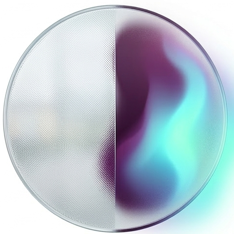

# Marina | Independent Researcher & AI/ML Engineer

 **Independent Researcher** | Exploring human-centered AI, cognitive systems, computer vision, and computational approaches to understanding complex patterns  
🏢 **Senior AI/ML Engineer at Nutanix** | 15+ years in software engineering, building LLM, RAG, agentic, and graph-based systems for system intelligence

---

### 🧩 Technical Focus
* **AI Systems:** LLM applications, RAG and GraphRAG, agentic workflows, structured extraction, knowledge graphs
* **Machine Learning & Computer Vision:** PyTorch, Hugging Face Transformers, DINOv2, OpenCV, visual embeddings, representation learning, image retrieval
* **Human-Centered & Cognitive AI:** Cognitive modeling, temporal and graph-based reasoning, affective computing, explainability
* **Engineering & Infrastructure:** Python, FastAPI, Pydantic, Apache Spark, Neo4j, Docker, Ollama, AWS
  
---

### 🚀 Featured Research
**[BeliefTrace](https://github.com/AetherMarina/belief-trace)**  
An experimental cognitive AI research project for extracting structured belief representations from narrative text and tracing their temporal evolution. The framework consists of two core modules:
* **Belief Model**: A QLoRA/PEFT-based model for multi-label core-belief extraction.
* **Longitudinal Belief Graph**: A temporal state machine for modeling how inferred beliefs persist, conflict with new evidence, and change state across sequential narratives.

**Research Focus**: Synthetic data augmentation, ablation studies, multi-label evaluation, hallucination tracking, confusion matrix analysis, and paired bootstrap significance testing.

**[Affective-Bridge](https://github.com/AetherMarina/affective-bridge)**  
A middleware system for affective signal interpretation and affect-aware AI interaction, with a focus on privacy and explainability.

---

### 🧭 Current Explorations

My research explores how machine learning can uncover and reason over complex patterns across **visual, cognitive, affective, and temporal data**.

I am currently exploring **computer vision and computational iconography**, including visual representation learning, motif retrieval, and fine-grained geometric discrimination, with longer-term interest in connecting visual evidence with historical context, knowledge graphs, and grounded AI reasoning.

In parallel, I continue exploring **human-centered and cognitive AI**, including affective modeling, longitudinal representations of beliefs and internal state, and graph-based approaches to understanding how patterns evolve across time and context.

Across these directions, I am particularly interested in systems that combine **representation learning, structured knowledge, explainability, and human interpretation** rather than treating perception or reasoning as isolated problems.

---

### 📬 Connect with Me
- 
- 

